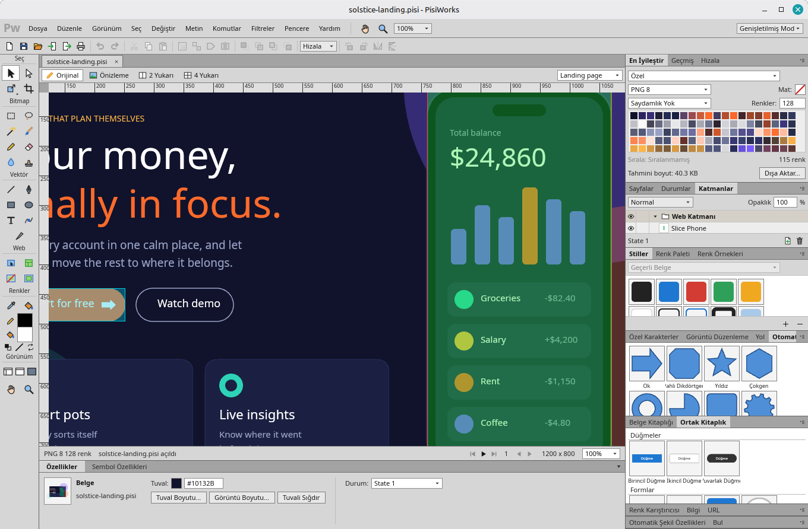
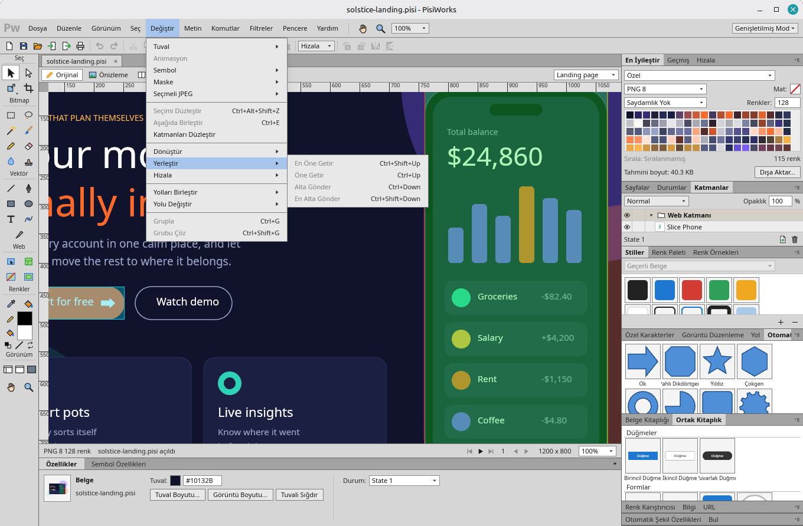
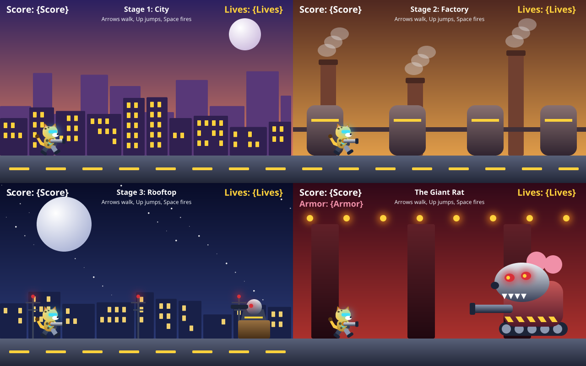

<h1 align="center">PisiWorks</h1>

<p align="center">
  <strong>Pardus için, Türkçe arayüzlü, açık kaynak bir Adobe Fireworks benzeri.</strong><br>
  Fireworks'ü hâlâ derslerinde anlatan öğretmenler ve öğrencileri için.
</p>

<p align="center">
  <a href="COPYING"></a>
  
  
  
</p>

<p align="center">
  <a href="#kurulum">Kurulum</a> ·
  <a href="#özellikler">Özellikler</a> ·
  <a href="#pisiworkste-neler-yapıldı">Neler yapıldı</a> ·
  <a href="docs/guide.tr.md">Kullanım kılavuzu</a> ·
  <a href="README.en.md">English</a>
</p>

<p align="center">
  
</p>

> **PisiWorks'ü Murat SAPMAZ geliştiriyor**; Türkiye'deki okullar ve Pardus kullanıcıları için bağımsız bir özgür yazılım projesidir. Temeli, [Med Amine Belbachir](https://medamineweb.com/)'in yazdığı [Emberframe](https://github.com/gregstein/emberframe)'dir: o olmasaydı bu proje bu kadar kısa sürede var olamazdı, kendisine teşekkür ederiz. Bugünkü kodun yaklaşık üçte biri Emberframe'den gelir, üçte ikisi PisiWorks için yazıldı; [neler yapıldığı aşağıda](#pisiworkste-neler-yapıldı).

## Amaç

**Bu proje ticari bir amaç taşımaz.** PisiWorks ve PisiAnimasyon ücretsizdir ve ücretsiz kalacaktır: satılmaz, reklam göstermez, bağış istemez, veri toplamaz. Tek amaçları, müfredatında hâlâ Fireworks ve Flash anlatılan okullarda Pardus kullanan öğretmen ve öğrencilerin dersi kendi bilgisayarlarında işleyebilmesidir. Adobe'nin bir ürününün yerine geçmeyi değil, o araçların çalışmadığı bir yerde dersin sürmesini hedefler.

## Neden PisiWorks

Adobe, Fireworks'ü geliştirmeyi 2013'te bıraktı; ama vektör çizimi, bitmap düzenlemeyi, durumları ve web için dışa aktarmayı tek pencerede toplayan bu program okullarda hâlâ anlatılıyor. PisiWorks, aynı çalışma biçimini Pardus üzerinde, Türkçe olarak ve özgür yazılım olarak sunmayı amaçlar.

Bilerek bir benzeridir: aynı yerleşik düzen, araç grupları, paneller ve açık gri arayüz; kısa menü ve komut adları da, öğretmenin ders notundaki adım öğrencinin ekranındakiyle aynı olsun diye, Türkçe Fireworks'te kullanılan terimlerle aynı tutulmuştur. İletiler, açıklamalar ve belgeler bu proje için yazılmıştır. Kendi adıyla yayımlanır, bütün simgeleri yeniden çizilmiştir ve Adobe'ye ait hiçbir kod ya da görsel içermez.

## Özellikler

| Alan | Neler var |
|---|---|
| **Araçlar** | İşaretçi, Arkasındakini Seç, Alt Seçim, Ölçek, Eğriltme, Deformasyon, Kırpma, Seçim Çerçevesi, Oval Seçim Çerçevesi, Kement, Çokgen Kement, Sihirli Değnek, Fırça, Kurşun Kalem, Silgi, Bulanıklaştırma, Keskinleştir, Soldurma, Yakma, Leke, Lastik Damgası, Renk Değiştir, Kırmızı Göz Kaldırma, Damlalık, Boya Kovası, Degrade, Çizgi, Kalem, Vektör Yol, Dikdörtgen, Elips, Çokgen, Metin, Serbest Biçim, Bıçak, Sıcak Nokta, Dilim, El, Yakınlaştırma |
| **Paneller** | En İyileştir, Geçmiş, Hizala, Sayfalar, Durumlar, Katmanlar, Stiller, Renk Paleti, Renk Örnekleri, Yol, Otomatik Şekiller, Belge Kitaplığı, Ortak Kitaplık, Renk Karıştırıcısı, Bilgi, URL, Bul, Özel Karakterler, Görüntü Düzenleme, Özellikler, Sembol Özellikleri |
| **Vektör** | Bezier eğrileri ve nokta düzenleme, Otomatik Şekiller, yolları birleştirme (Birleştir, Böl, Topla, Kesiştir, Zımbala, Kırp), Basitleştir, Konturu Genişlet, Yolu Daralt ve Yolu Genişlet |
| **Dönüştürme** | Ölçek, Eğriltme, Deformasyon, taşınabilir merkez noktası, Sayısal Dönüştürme, döndürme ve çevirme |
| **Görünüm** | Degrade (12 tür) ve desen dolguları, 45 karışım modu, maskeler, 29 canlı filtre (Düzeyler ve Eğriler dahil), on efektli Photoshop Canlı Efektleri, stiller |
| **Bitmap** | Boyama, silme, klonlama, doldurma, piksel seçimleri, Geçiş Yumuşatma, Benzerini ve Tersini Seç, seçim çerçevesi komutları, Seçimi ve Katmanları Düzleştir |
| **Metin** | Kurulu fontlar, kalın, italik, altı çizili, hizalama, dikey ve sağdan sola metin yönü, yola eklenen metin, yazım denetimi, Yollara Dönüştür |
| **Düzen** | Cetveller, boyutu ve rengi ayarlanan ızgara ve Izgaraya Bitiştir, kılavuzlar, akıllı kılavuzlar, dilim kılavuzları, gruplar ile Üst Seç ve Alt Seç |
| **Ekranlar ve animasyon** | Sayfalar, katmanlar, paylaşılan katmanlar, durumlar, soğan zarı, semboller ve kitaplık, sembolü yerinde düzenleme, dört durumlu düğme sembolleri (Önizleme'de ve dışa aktarılan HTML'de fareyle değişir), Seçimi Canlandır |
| **Dışa aktarma** | PNG 8, PNG 24, PNG 32, JPEG (seçmeli kalite ve yumuşatma ile), GIF ve animasyonlu GIF; Önizleme, 2 Yukarı ve 4 Yukarı karşılaştırma; dilimler ve HTML görüntü eşlemleri |
| **Belgeler** | Kendi `.pisi` dosyaları (Emberframe'in `.ember` dosyaları da açılır), yaygın görüntü biçimlerini açma ve içe aktarma, Tuval Boyutu, Görüntü Boyutu, Tuvali Sığdır ve Tuvali Kes |
| **Yazdırma** | Sayfa Yapısı, kurulu yazıcıya gönderme veya PDF olarak kaydetme |
| **Dil** | Türkçe ve İngilizce; Düzenle > Dil menüsünden değiştirilir |

<p align="center">
  
</p>

## Kurulum

Derleme ve paketleme Linux Mint 22.3 üzerinde yapılır. `.deb` paketi hedef sistem olan **Pardus 25 üzerinde kurulup çalıştırıldı** (Kasım 2026).

### Paketle kurma

Hazır paket [sürümler sayfasından](https://github.com/MuratSAPMAZ/PisiWorks/releases) indirilir ve `sudo apt install ./pisiworks_0.2.0_amd64.deb` ile kurulur; sürüm notları [`docs/surum-notlari/`](docs/surum-notlari/) klasöründedir.

Paket kaynaktan da tek komutla üretilir (aşağıdaki derleme gereksinimleri kurulu olmalıdır):

```bash
packaging/build-deb.sh
```

Paket `target/deb/` klasörüne yazılır ve şöyle kurulur:

```bash
sudo apt install ./target/deb/pisiworks_0.2.0_amd64.deb
```

Kurulumdan sonra PisiWorks uygulama menüsünün Grafik bölümünde görünür ve `.pisi` dosyaları çift tıklayınca PisiWorks ile açılır. Pakete yazılan bakımcı adı `DEB_MAINTAINER` ortam değişkeninden, o yoksa git'in `user.name` ve `user.email` ayarlarından alınır.

### Kaynaktan derleme

Gerekenler: Rust 1.91 veya üzeri ([rustup](https://rustup.rs/) ile kurulabilir) ve şu paketler:

```bash
sudo apt install build-essential pkg-config libxcb1-dev libxkbcommon-dev libxkbcommon-x11-dev
```

Program ekrana Vulkan ile çizer. Ekran kartı sürücüsü Vulkan desteklemiyorsa yazılımsal sürücü de iş görür:

```bash
sudo apt install mesa-vulkan-drivers
```

Derleyip çalıştırmak için:

```bash
git clone https://github.com/MuratSAPMAZ/PisiWorks.git
```

```bash
cd PisiWorks
```

```bash
git checkout pisiworks
```

```bash
cargo run --release
```

İlk derleme uzun sürer. Program açılınca Ctrl+O ile [`examples/solstice-landing.pisi`](examples/solstice-landing.pisi) dosyasını açıp ekran görüntülerindeki tasarımı inceleyebilirsiniz. Araçlar ve paneller [kullanım kılavuzunda](docs/guide.tr.md) anlatılıyor.

Testleri çalıştırmak için:

```bash
cargo test
```

Yazdırma için sistemin yazdırma hizmeti (CUPS) gerekir.

## PisiWorks'te neler yapıldı

PisiWorks, Emberframe 0.1'den çatallandı. Emberframe bize sağlam bir başlangıç verdi: pencere düzeni, araç paleti ve paneller, simgeler, katmanları, sayfaları, durumları ve sembolleriyle nesne modeli, temel çizim ve bitmap araçları, yol işlemleri, Otomatik Şekiller ve dışa aktarma ondan gelir, ve o kodun yaklaşık %88'i hâlâ yerindedir.

Üzerine, Fireworks'ü derste anlatan bir öğretmenin ihtiyaç duyacağı her şeyi tek tek ekledik. Emberframe'in menülerinde 42 komut gri duruyordu; PisiWorks'te gri komut yok.

| | Emberframe 0.1 | PisiWorks |
|---|---|---|
| Kaynak kod | 16 dosyada 12.286 satır | 35 dosyada 37.312 satır (iki program) |
| Otomatik test | 141 | 318 |
| Menüde çalışmayan (gri) komut | 42 | 0 |
| Arayüz dili | İngilizce | Türkçe ve İngilizce |

PisiWorks için yazılanlar:

| Alan | PisiWorks'te eklenen |
|---|---|
| **Linux ve Pardus** | Linux'ta derlenip çalışma, giriş yöntemiyle Türkçe harf yazınca oluşan çökmenin düzeltilmesi, kurulu fontlardan seçim, grafik sürücüsü eksikse anlaşılır bir uyarı, `.deb` paketi, uygulama simgesi ve `.pisi` dosya türü |
| **Türkçe** | Türkçe Fireworks'ün terimleriyle bütün arayüz, dil menüsü, çevirisi eksik metni yakalayan testler, Türkçe kullanım kılavuzu |
| **Araçlar** | 21 yeni araç: Arkasındakini Seç, Oval Seçim Çerçevesi, Çokgen Kement, Keskinleştir, Soldurma, Yakma, Leke, Renk Değiştir, Kırmızı Göz Kaldırma, Degrade, Vektör Yol, Yolu Yeniden Çiz, Çokgen, Serbest Biçim, Alanı Yeniden Şekillendir, Yol Süpürgesi, 9 Dilimli Ölçekleme, çokgen ve daire Sıcak Nokta ile Dilim araçları; araç grupları ve araç seçenekleri |
| **Vektör** | Bezier eğrileri, Kalem ve Alt Seçim araçlarıyla nokta ve tutamaç düzenleme, yol işlemlerinden sonra eğri uydurma |
| **Dönüştürme** | Taşınabilir merkez noktasıyla Ölçek, Eğriltme ve Deformasyon; Sayısal Dönüştürme |
| **Dolgu ve görünüm** | 12 türde degrade dolgu, desen ve web renk taklidi dolguları, tuvalde degrade tutamaçları, kenar ve doku; 45 karışım modu; bütün komutlarıyla maskeler |
| **Filtreler** | Düzeyler ve Eğriler dahil 29 canlı filtre; on efekti, bütün ayarları ve degrade düzenleyicisiyle Photoshop Canlı Efektleri |
| **Bitmap** | Seçili pikselleri taşıma, Geçiş Yumuşatma, Benzerini ve Tersini Seç, seçim çerçevesi komutları, Seçimi Düzleştir, Aşağıda Birleştir, Katmanları Düzleştir |
| **Metin** | Font, kalın, italik, altı çizili, beş hizalama, dikey ve sağdan sola metin, yola eklenen metin, sistem sözlükleriyle Türkçe yazım denetimi |
| **Düzen** | Kılavuzlar, akıllı kılavuzlar, dilim kılavuzları, ayarlanabilir ızgara ve Izgaraya Bitiştir, gruplar için Üst Seç ve Alt Seç |
| **Semboller ve animasyon** | Sembolü yerinde düzenleme, Yeni Sembol, dört durumlu düğme sembolleri (Önizleme'de ve dışa aktarılan HTML'de fareye tepki verir), Seçimi Canlandır ve sürüklenebilir animasyon yolu |
| **Dosyalar** | Fireworks PNG dosyalarının katmanlarını okuma, Şablondan Yeni ve Şablon Olarak Kaydet, Toplu İşleme, Görüntü Önizleme, kendi JPEG kodlayıcısıyla seçmeli JPEG kalitesi |
| **Komutlar** | Geçmiş'teki adımları komut olarak kaydetme ve yeniden çalıştırma, komut dosyaları, hazır komutlar (Ok Başları, Resim Çerçevesi, Gölge, Otomatik Vektör Maskesi, Bük ve Soldur, Gri Tonlama, Sepya, Katmanlara Dağıt ve diğerleri) |
| **Yazdırma** | Sayfa Yapısı, sayfa aralığı, büyük sayfaları kâğıtlara döşeme, yazıcıya gönderme ya da PDF |
| **Ayarlar** | Tercihler ve her menü komutuna yeniden atanabilen klavye kısayolları |
| **Animasyonlu GIF** | Animasyonlu GIF'i durumlar olarak açma, döngü sayısı, Örneklerin Arasını Doldur ile ara kareler, sağ menüde resim dosyalarından tek adımda GIF yapan GIF Oluştur |
| **Örnekler** | Menü çubuğunun sağında, Fireworks menülerinden ayrı duran Örnekler menüsü: açılıp incelenecek ve değiştirilecek yedi hazır belge (web afişi, gezinme düğmeleri, animasyon, okul afişi, degradeler, filtreler, web sayfası taslağı) |

Rakamlar Kasım 2026'ya aittir ve çalışma sürdükçe değişecektir.

## PisiAnimasyon: animasyon programı (ilk aşama)

Aynı depodan ikinci bir program derlenir: **PisiAnimasyon**, okullarda hâlâ anlatılan Adobe Flash'ın çalışma biçimini örnek alan bir animasyon programı. PisiWorks'ün çizim araçlarının, filtrelerinin ve sembollerinin tamamını kullanır; sahnenin altına bir zaman çizelgesi ekler.

```bash
cargo run --release --bin pisianimasyon
```

Bu aşamada çalışanlar:

- Zaman çizelgesi: katmanlar, kareler, anahtar kareler ve boş anahtar kareler (F5, F6, F7; kaldırmak için Shift+F5, Shift+F6).
- Hareket ara doldurma: iki anahtar kare arasında konum, boyut, dönüş ve opaklık adım adım değişir. Ara doldurmanın içindeki bir karede nesneyi değiştirmek, Flash'ta olduğu gibi o kareyi anahtar kare yapar.
- Şekil ara doldurma: bir anahtar karedeki şekiller, dış hatları ve renkleriyle, sonraki anahtar karedekilere dönüşür.
- Şekil ipuçları (Ctrl+Shift+H): şeklin bir noktasının hangi noktaya dönüşeceğini belirleyen, sahnede sürüklenen harfli işaretler.
- Kılavuz katmanı: ona bağlı katmanların ara doldurulan nesneleri kılavuzdaki yol boyunca ilerler; istenirse yolun yönüne döner. Maske katmanı: ona bağlı katmanlar yalnızca maskede çizili olan yerde görünür. Bir kılavuza ya da maskeye birden çok katman bağlanabilir. Kılavuzlar yayımda çizilmez; maskeler Önizleme'de, yayımda ve, Flash'ta olduğu gibi, katmanları kilitlenince sahnede de uygulanır.
- Yavaşlama (−100 ile 100 arası) ve hareket ara doldurmada tur sayısı.
- Film klibi sembolleri: kendi zaman çizelgesi olan semboller. Kopyasına çift tıklayınca klibin kendi sayfası açılır; yayımlanan filmde sahne dursa bile kendi karelerini oynatır.
- Düğme sembolleri ve hazır eylemler: Dur, Oynat, Kareye Git ve Oynat, Kareye Git ve Dur, Sahneye Git, Adrese Git. Eylem bir anahtar kareye ya da bir düğmeye verilir; kod yazmak gerekmez.
- Sahneler: Sahneler panelindeki her sayfa bir sahnedir; film sahneleri sırayla oynatır.
- Ses: MP3, OGG ya da WAV dosyası içe aktarılır ve bir anahtar karede başlatılır.
- Filmi Test Et (Ctrl+Enter): filmi yayımlayıp tarayıcıda açar.
- Sağ tık menüleri: zaman çizelgesinde bir kareye sağ tıklayınca ara doldurma, kare ve anahtar kare komutları; katman adına sağ tıklayınca katman komutları; sahnede bir nesneye ya da boş yere sağ tıklayınca düzenleme, yerleştirme, dönüştürme ve sembol komutları. PisiWorks'ün tuvalinde de aynı menü vardır.
- Oynatma, kare kare ilerleme, kare hızı ve soğan zarı.
- Flash'taki gibi sona kadar bir kez oynatma, seçenek olarak Döngülü Oynat; doğrudan bir kareye ya da saniyeye gitme kutuları, cetvelde saniye işaretleri, uzun filmlerde oynatma kafasını izleyen zaman çizelgesi.
- Flash'taki gibi dönüştürme noktası: Ölçekle aracıyla taşınır, nesneyle birlikte kalır, hareket ara doldurması nesneyi onun çevresinde döndürür; böylece kol omuzdan döner.
- **Davranışlar**, PisiAnimasyon'un kendi özelliği: bir nesneye tek tıkla verilen on dokuz hazır davranış; anahtar kare gerekmez. Dön, zıpla, git gel, in çık, sürekli git, titre, büyü küçül, yanıp sön, belir kaybol, bir süre sonra kaybol; ve yayımlanan film için dokuzu: fareyi izle, ok tuşlarıyla yürü, düş ve zıpla, sürüklenebilir, kenarlardan sek, teker gibi yuvarlan, kamera beni izlesin, arka plan gibi kay (yana kayan kamera ve paralel arka plan) ve katı (zemin, platform, duvar).
- **Kurallar**, PisiAnimasyon'un kendi özelliği: kod yazmadan oyun. Kural bir olay ve eylemlerdir; ikisi de listeden seçilir ve cümle olarak görünür: "Elma nesnesi Sepet nesnesine değince: Puan sayısını 1 artır". Olaylar: başlangıç, tuş, tıklama, iki nesnenin değmesi, sahnenin kenarı, her şu kadar saniye, bir sayının bir değere gelmesi. Kuralın koşulu olabilir ("Puan 2 değerinden büyükse"); kural bir nesnenin kopyasını oluşturabilir (mermi), nesneyi silebilir, hızlandırabilir, döndürebilir, büyütüp küçültebilir, saydamlaştırabilir, ona bir davranış verip geri alabilir bir nesneyi ötekinin peşine takabilir, bir nesneyi ötekine bağlayabilir ve hızlanıp yavaşlayan bir harekete çıkarabilir (tuş bırakılınca olayıyla birlikte: tekerleri dönen, yavaşlayarak duran bir araba). Puan gibi sayıları, içinde `{Puan}` geçen her yazı gösterir.
- **Dil**: kurallar yazılabilir de. **Kurallar > Kuralları Yaz** oyunu Türkçe cümleler olarak açar (`Elma nesnesi Sepet nesnesine değince:`); yazılan satır anında okunur, okunamayan satır nedeniyle birlikte kırmızı görünür. Yazıda listelerden fazlası vardır: işlemler (`Puan * 2`, `Gemi.x + 20`, `rastgele(1, 6)`), `ve` ile birden çok koşul, `değilse`, `bekle`, döngüler (`3 kez yinele:`), iç içe `eğer` blokları ve adıyla çağrılan komutlar (`Patlat komutu:`). Yazarken imlecin altında cümle ve ad önerileri çıkar; Tab alır. Program İngilizce kullanılırken aynı kurallar İngilizce cümlelerle okunur.
- Kılavuz programın içindedir: **Yardım > Kullanım Kılavuzu** (F1) onu tarayıcıda açar; internet gerekmez. PisiAnimasyon'da doğrudan animasyon ve oyun derslerinin başladığı yerde açılır.
- **Pisi: Demir Pençe**, vitrin oyunu: silahlı bir robot pars, karşılık veren robot fareler, dronlar, üç bölüm ve sonda dev bir fare. Yirmi sekiz kural, tek satır kod yok; Örnekler menüsünden açıp hepsini okuyabilirsiniz.

<p align="center"></p>

- Örnekler menüsünde on beş hazır film daha: zıplayan top, değişen şekiller, yol boyunca, spot ışığı, dönen dişliler, sırayla, çöp adam dövüşü, davranışlar, çizilmiş karakterleri, hareket eden manzarası, parlamaları ve programda üretilmiş sesleriyle beş oyun (elma yakala, hedef vurma, platform, uzay atışı, bilgi yarışması), araba sürmek, düğmeli iki sahne. Kılavuzda her oyun bir ders olarak anlatılır. Kılavuzda dövüş adım adım ders olarak anlatılır.
- PisiWorks ile alışveriş: PisiWorks'teki **Dosya > PisiAnimasyon'da Aç** belgeyi animasyon programında, PisiAnimasyon'daki **Dosya > Kareyi PisiWorks'te Aç** o anki kareyi tasarım programında bir kopya olarak açar. **Dosya > İçe Aktar** iki programda da öbürünün belgesini, nesneleri ve sembolleriyle birlikte içeri alır.
- `.sahne` belgeleri. PisiWorks `.sahne` dosyalarını, PisiAnimasyon `.pisi` dosyalarını açar; çizimler iki program arasında olduğu gibi geçer.
- **Kontrol > HTML5 Olarak Yayımla**: animasyonu tarayıcıda oynayan tek bir HTML dosyasına yazar. Her kare programın çizdiği haliyle bir resim olarak sayfanın içindedir.

**Site ve kitap:** [muratsapmaz.github.io/PisiAnimasyon](https://muratsapmaz.github.io/PisiAnimasyon/) (deposu: [MuratSAPMAZ/PisiAnimasyon](https://github.com/MuratSAPMAZ/PisiAnimasyon); sayfaları buradaki `docs/site/` ve `docs/kitap/` klasörlerinden `packaging/site.py` üretir).

**PisiAnimasyon Kitabı.** Öğrenci ve öğretmen için, resimli ve ders ders ilerleyen bir kitap PisiAnimasyon ile birlikte gelir: 31 bölüm, altı kısım (başlarken, hareket, oyun kuralları, altı oyun dersi, kuralları yazmak, çizim ve karakter) ve ekler (bütün cümleler, kısayollar ve sık sorulanlar, öğretmen için dönemlik plan). Her bölüm programın ekran görüntüleriyle adım adım anlatır, "Takıldıysan" ve "Sıra sende" bölümleri ve bir öğretmen notu taşır. Kitabın iki sürümü vardır: **resimli sürümde** örnekler ekran görüntüsüdür ve yazdırmaya uygundur; **canlı örnekli sürümde** aynı örnekler sayfanın içinde gerçekten oynayan filmlerdir (yirmi film: üstüne tıklayıp oynanır). Her sayfanın üstündeki bağlantı öbür sürüme geçirir. PisiAnimasyon'da **Yardım > Kullanım Kılavuzu** (F1) canlı sürümü tarayıcıda açar. Kaynağı `docs/kitap/` klasöründedir; `packaging/kitap.py` sayfaları üretir.

Pencere, Flash'ın klasik çalışma alanı gibi düzenlenir: zaman çizelgesi sahnenin üstünde, araçlar solda, Özellikler altta; katmanlar zaman çizelgesindedir. Enter oynatır. `.deb` paketi iki programı birlikte kurar.

Flash'tan bilinen farklar: ActionScript yoktur, yerine hazır eylemler vardır. `.fla` ve `.swf` dosyaları açılmaz ve yazılmaz. Yayımlanan sayfada her kare ve her klip karesi bir resimdir. İç içe film klipleri de kendi kareleriyle oynar; yalnız bir klibin içine konan düğme yayımlanan filmde tıklanamaz (sahnedeki düğmeler tıklanır). Program içinde oynatırken (Enter) kare eylemleri çalışmaz ve klipler ilk kareleriyle görünür, Flash'ta olduğu gibi; filmin tamamı Filmi Test Et ile görülür.

Türkçe terimler ("Zaman Çizelgesi", "Anahtar Kare", "Hareket Ara Doldurması") elimizde Türkçe Flash kurulumu olmadığı için bizim çevirimizdir ve ders notlarındaki sözcüklerden farklı olabilir. Hepsi tek bir çeviri tablosundadır; doğrusunu bildirirseniz düzeltilir.

## Bu sürümde olmayanlar

- Fireworks'ün JavaScript (JSF) komut dosyaları ve uzantıları: Komut Dosyası Çalıştır yalnızca PisiWorks'ün kendi komut dosyalarını (her satırda bir menü komutu) çalıştırır. Komutlar menüsünün hazır komutları Fireworks'ünkilerin iletişim kutularıyla birebir aynı değildir: Ok Başları Ekle beş biçim, Otomatik Vektör Maskesi yedi maske sunar. Adobe'nin şablonları da yoktur; Şablondan Yeni kendi şablonlarımızı ve sizin kaydettiklerinizi listeler.
- Fireworks PNG dosyalarındaki yollar, metinler ve gruplar. Katmanlar, durumlar, bitmap nesneleri ve Alt Gölge efekti okunur; içinde yol, metin ya da grup olan dosya düz görüntü olarak açılır. Biçim Adobe tarafından yayımlanmadığı için okuyucu Fireworks 8 ile yazılmış birkaç dosyadan çıkarıldı; başka sürümlerin dosyalarıyla denenmedi. Fireworks PNG yazılmaz.
- Photoshop Canlı Efektleri'nde Photoshop'un kendi desen ve degrade kitaplıkları.
- Pardus deposunda yer almak. Hazır `.deb` paketi şimdilik sürümler sayfasından indirilir; `apt` ile kendiliğinden güncellenmez.

Program gerçek Adobe Fireworks ile yan yana karşılaştırılarak sınanmadı; filtrelerin ve karışım modlarının piksel sonuçları Fireworks'tekilerden farklı olabilir. Tek istisna: Fireworks 8 ile yazılmış bir dosyadaki Alt Gölge (yumuşaklık 1) bizim çizimimizle karşılaştırıldı ve 289 pikselin 287'si aynı çıktı. Karşılaştığınız farkları ve hataları bildirirseniz düzeltilir.

## Kimlik, lisans ve teşekkür

**PisiWorks**'ü **Murat SAPMAZ** geliştirir ve sürdürür: [muratsapmaz.web.app](https://muratsapmaz.web.app/) · [github.com/MuratSAPMAZ/PisiWorks](https://github.com/MuratSAPMAZ/PisiWorks). Hata bildirimleri, öneriler ve katkılar oradan beklenir. Bağımsız bir projedir; Pardus'u geliştiren TÜBİTAK ULAKBİM ile ya da Adobe ile kurumsal bir bağı yoktur.

**Teşekkür.** PisiWorks, **Med Amine Belbachir**'in yazıp MIT lisansıyla herkese açtığı Emberframe'in üzerinde yükselir. Emeği ve cömertliği için kendisine teşekkür ederiz:

- Web sitesi: [medamineweb.com](https://medamineweb.com/)
- Emberframe: [github.com/gregstein/emberframe](https://github.com/gregstein/emberframe) · [proje sayfası](https://medamineweb.com/en/emberframe/)
- GitHub: [@gregstein](https://github.com/gregstein)

**Lisans.** PisiWorks ve PisiAnimasyon, [GNU Genel Kamu Lisansı, sürüm 3 ya da sonrası](COPYING) ile yayımlanan özgür yazılımlardır: herkes kullanabilir, inceleyebilir, değiştirebilir ve dağıtabilir; değiştirip dağıtan da kendi sürümünün kaynak kodunu aynı lisansla vermelidir. Emberframe'den gelen kod, yazarının [MIT lisansı](LICENSES/MIT.txt) altında kalır. Lisansa üç ek koşul eklenmiştir ([NOTICE](NOTICE)): Hakkında penceresindeki geliştirici ve kaynak bilgisi korunur; değiştirilmiş bir sürüm değiştirilmiş olduğunu açıkça söyler; **PisiWorks ve PisiAnimasyon adları ile simgeleri değiştirilmiş sürümlerde kullanılamaz**, böyle bir sürüm kendi adını taşır. **Programlarla yaptığınız film ve sayfalar sizindir**; içlerine yazılan oynatıcı betiğiyle birlikte dilediğiniz koşulla dağıtabilirsiniz ([NOTICE](NOTICE)). Kodun kökeni, içine derlenen kitaplıkların lisansları ve Adobe ile ilişkisi [lisans ve telif bildirimi](docs/lisans-ve-telif.md) belgesinde ayrıntısıyla yazılıdır.

Adobe, Fireworks, Flash, Photoshop ve ActionScript, Adobe Inc.'in ticari markalarıdır. PisiWorks ve PisiAnimasyon Adobe'ye ait hiçbir kod, görsel ya da belge içermez; Adobe ile hiçbir bağlantıları yoktur ve Adobe tarafından onaylanmamıştır. Bu adlar yalnızca programların neyin benzeri olduğunu ve hangi dosyaları açabildiğini anlatmak için kullanılır.
